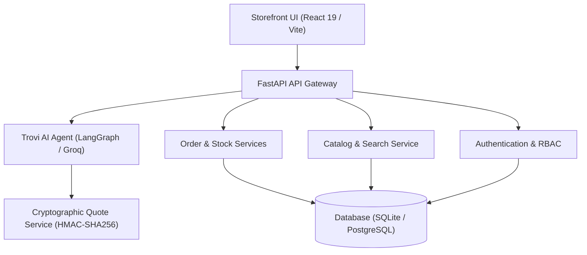

# 🛍️ Trovi

> **Bolo, Trovi dhoond dega. Ask. Compare. Buy.**

[](https://github.com/Alister007-arch/shopi.ai/actions)
[](https://fastapi.tiangolo.com)
[](https://react.dev)
[](https://vitejs.dev)
[](https://langchain.com)
[](https://pytest.org)
[](LICENSE)

**Trovi** is a multi-category AI commerce platform spanning 7 departments: **Grocery, Fashion, Electronics, Laptops, Home & Kitchen, Personal Care, and Luxury**. Featuring **MOSS Organics** as a dedicated collection for organic farm-to-table groceries, Trovi pairs an editorial storefront with **Trovi AI** ("Ask Trovi"), an autonomous conversational shopping assistant built on FastAPI, React 19, LangGraph, and Groq LLMs.

---

## 🌟 Platform Highlights

- **7-Department Category Hierarchy**: Hierarchical category tree with parent/child relationships and category-specific policy schemas across 40 leaf categories.
- **Category-Aware Conversational Assistant**: Trovi AI handles intent disambiguation, comparison, and policy inquiries with bilingual English and Hinglish support.
- **Two-Step Cryptographic Quote Confirmation**: Time-bound HMAC-SHA256 signed quote tokens prevent price drift, prompt injection exploitation, and unauthorized order placement.
- **Concurrency & Flash-Sale Stock Safety**: Pessimistic locking (`BEGIN IMMEDIATE`) and atomic decrements prevent overselling under high concurrency.
- **Deterministic Order Lifecycle**: Explicit state machine with automated cancellation inventory replenishment and Indian GST tax invoice generation.
- **Security & Secret Hygiene**: Zero hardcoded credentials, bcrypt password hashing, RBAC enforcement, and automated secret scanning.

---

## 🏗️ Architecture



---

## 🚀 Run Instructions

### Required Environment Variables

Configure the following variables in your local `.env` (copy from `.env.example`). Variable names only:

| Variable | Description |
|---|---|
| `GROQ_API_KEY` | Groq API key for conversational agent inference |
| `JWT_SECRET_KEY` | Secret key for signing authentication tokens |
| `ENVIRONMENT` | Target runtime environment (`development`, `production`, `testing`) |
| `DEMO_MODE` | Enables demo account seeding in development mode only (`true` / `false`) |
| `ADMIN_EMAIL` | Initial administrator email address |
| `ADMIN_PASSWORD` | Initial administrator password (hashed on startup) |
| `ADMIN_PASSWORD_RESET` | Set to `true` to overwrite an existing admin password on startup (default `false`) |
| `SHOPI_DB_PATH` | Path to SQLite database file |
| `DATABASE_URL` | PostgreSQL connection URL (optional alternative to SQLite) |
| `PORT` | Server listening port |
| `CORS_ORIGINS` | Comma-separated allowed HTTP origins |

### Local Development Setup

1. **Clone and Install Backend Dependencies**:
   ```bash
   git clone https://github.com/Alister007-arch/shopi.ai.git trovi
   cd trovi
   pip install -r backend/requirements.txt
   ```

2. **Initialize Database**:
   ```bash
   python backend/setup_db.py
   ```

3. **Start Backend Server**:
   ```bash
   python backend/main.py
   ```

4. **Start Frontend Client**:
   ```bash
   cd frontend
   npm install
   npm run dev
   ```

### Docker Deployment

```bash
# Build the unified production image
docker build -t trovi .

# Run the container with environment file
docker run --rm -p 8000:8000 --env-file backend/.env trovi
```

---

## 🧪 Test Commands

Run the automated test suites locally:

```bash
# 1. Run full Pytest suite (Admin, Auth, Concurrency, Safety, Lifecycle, Orders)
python -m pytest backend/tests/ -v

# 2. Run the 60-Evaluation Agent Safety Benchmark
python evals/run_evals.py

# 3. Run legacy integration test suite
python backend/test_suite.py

# 4. Verify brand rename integrity (zero legacy brand strings)
python scripts/verify_brand_rename.py

# 5. Build frontend production assets
cd frontend && npm run build
```

---

## 🔒 Security

Trovi enforces strict credential isolation and security best practices:
- **No Hardcoded Passwords**: All administrator accounts are created strictly from `ADMIN_EMAIL` and `ADMIN_PASSWORD`. If missing, admin creation is skipped with a warning; no default credentials are ever provisioned in any environment.
- **Protected Admin Passwords**: Existing administrator passwords are never overwritten on startup unless `ADMIN_PASSWORD_RESET=true` is explicitly configured.
- **Live Admin Rotation**: Use `scripts/create_admin.py` or the Render Dashboard to rotate administrator credentials.
- **Production Guardrails**: Demo accounts are blocked from production creation, with startup alerts for known legacy accounts.
- **Compromised Git History**: Former default/demo passwords in git history are compromised and invalid. Never reuse them.
- **Automated CI Scanning**: Every pull request and push is checked by TruffleHog secret scanning.

For comprehensive security architecture, password rotation runbooks, and production Render configuration, refer to:
👉 **[Trovi Security Architecture & Operations Guide](docs/security.md)**

---

## 📂 Documentation

- 📖 [System Architecture Specification](docs/architecture.md)
- 🔒 [Security Operations & Rotation Guide](docs/security.md)
- 🚀 [Render Deployment Guide](docs/deploy-render.md)
- 🛠️ [Production Operations Runbook](docs/runbook.md)
- 📋 [Order Action Service Specification](docs/order-actions.md)
- 📜 [Assets & Typography Licenses](docs/assets-and-licenses.md)
