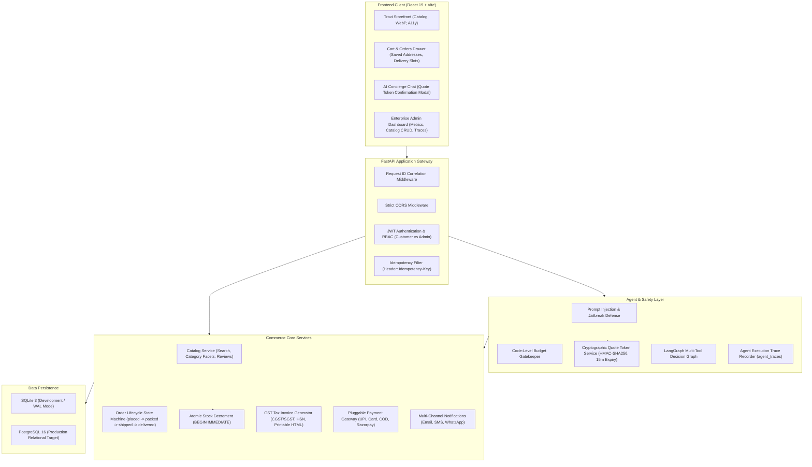
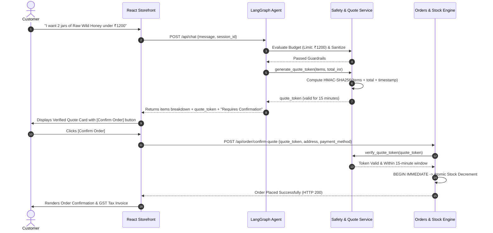
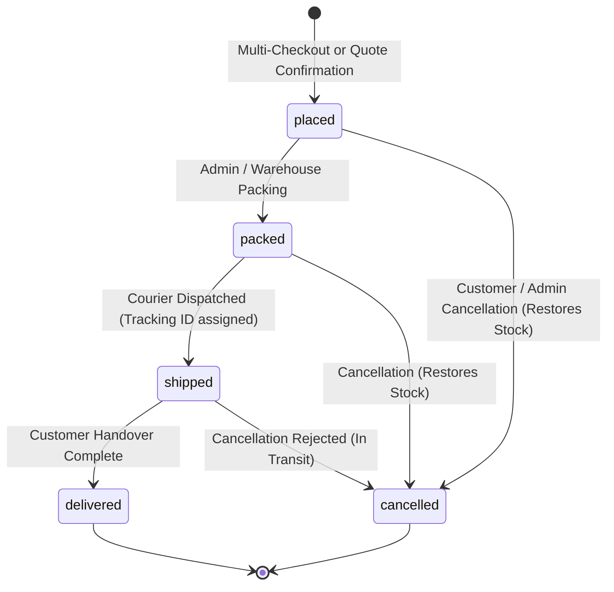

# Trovi — System Architecture & Design Specification

This document details the architectural principles, component interactions, safety boundaries, and technical decisions governing the **Trovi** autonomous e-commerce platform.

---

## 1. System Overview & Philosophy

Trovi marries a high-touch, editorial storefront aesthetic with an autonomous conversational commerce engine. The system balances frictionless AI assistance with strict transactional integrity:
- **Zero Hallucination Orders**: The AI agent can *never* unilaterally debit funds or commit database state without user confirmation.
- **Cryptographic Trust**: Orders originated via chat must present a tamper-proof HMAC-SHA256 quote token signed by the backend.
- **Absolute Inventory Safety**: Flash-sale concurrency is protected via atomic database row-level locking (`BEGIN IMMEDIATE`) preventing stock overselling.
- **Regulatory Compliance**: Integrated GST invoicing with reverse calculation (CGST/SGST) and HSN taxonomy.

---

## 2. High-Level Architecture Diagram



---

## 3. The Two-Step Agent Safety Boundary

To prevent unauthorized order placement, price drift, or prompt-injection exploitation, Trovi enforces a **Two-Step Cryptographic Quote Pattern**:



### Key Security Properties:
1. **Cryptographic Integrity**: The token encodes item IDs, quantities, and agreed prices signed with `QUOTE_TOKEN_SECRET`. Any client tampering invalidates the signature.
2. **Replay Defense**: Once confirmed, the token is recorded in `agent_quotes` with `is_confirmed = 1`. Subsequent reuse attempts fail immediately.
3. **Time-Bound**: Expired tokens (>15 minutes) reject with `QUOTE_EXPIRED` to prevent price drift and stale inventory reservations.

---

## 4. Concurrency & Flash-Sale Stock Lock Architecture

To eliminate the stock oversell bug present in demo apps, Trovi utilizes pessimistic serialized execution:

### SQLite Implementation
```sql
BEGIN IMMEDIATE;
-- Read-modify-write executed atomically
UPDATE products
SET stock = stock - :quantity
WHERE id = :product_id AND stock >= :quantity;

-- If cursor.rowcount == 0, stock was insufficient
-- Immediately ROLLBACK and abort checkout
```

### Concurrency Ordering Matrix
When an order contains multiple line items, product IDs are sorted numerically prior to acquisition (`sorted(item.product_id)`) to eliminate database deadlock conditions across concurrent threads.

---

## 5. Order State Machine & Lifecycle

Orders follow a deterministic state machine managed by `lifecycle.py`:



### Cancellation Invariant
When an order transitions to `cancelled`:
1. The transition is wrapped in an atomic database transaction.
2. Every item line in `order_items` executes an atomic stock replenishment:
   `UPDATE products SET stock = stock + :qty WHERE id = :product_id`.
3. An audit notification is triggered via Email and SMS confirming order termination and stock restoration.

---

## 6. Indian GST Tax Invoicing Subsystem

Indian e-commerce compliance mandates itemized GST tax invoices. Trovi features an integrated reverse-calculation invoice generator:

- **Formula**:
  $$\text{Taxable Value} = \frac{\text{Total Paid}}{1 + \text{GST Rate}}$$
  $$\text{Total GST} = \text{Total Paid} - \text{Taxable Value}$$
  $$\text{CGST} = \frac{\text{Total GST}}{2}, \quad \text{SGST} = \frac{\text{Total GST}}{2}$$
- **HSN Classification**: Trovi catalog includes assigned HSN codes (e.g., Honey: `0409`, Organic Oils: `1515`, Tea & Beverages: `0902`).
- **Export Formats**: Standard JSON response schema and print-ready standalone HTML invoices (`GET /api/order/{id}/invoice/html`).

---

## 7. Pluggable Payment Subsystem

Payment execution follows an abstract provider interface:

```python
class PaymentProvider(ABC):
    @abstractmethod
    def initiate_payment(self, order_id: int, amount_inr: float, metadata: dict) -> PaymentInitiationResult:
        ...

    @abstractmethod
    def verify_payment(self, payment_id: str, signature: str = None) -> PaymentVerificationResult:
        ...
```

### Supported Implementations:
1. `UPIPaymentProvider`: Simulates or connects to instant VPA / QR code intent routing.
2. `CardPaymentProvider`: Simulates 3D Secure card network authorization.
3. `CODPaymentProvider`: Cash-on-Delivery with zero upfront debit and delivery collection verification.
4. `RazorpayPaymentProvider`: Production-ready Razorpay checkout SDK integration using HMAC-SHA256 signature verification.

---

## 8. Multi-Channel Notification Dispatch

The notification service (`backend/app/notifications/service.py`) provides asynchronous multi-channel fanout:
- **Email**: Dispatches HTML transactional templates for Order Placed, Shipped, Delivered, and Invoices.
- **SMS**: Dispatches high-urgency transactional SMS with order IDs and OTPs.
- **WhatsApp**: Dispatches conversational notifications via WhatsApp Business API templates.
- **Audit Logging**: Every dispatched notification is persisted in the `notifications` table with status (`sent`, `failed`, `queued`).

---

## 9. Evaluation & Benchmarking Infrastructure

To prevent regressions in agent reasoning and conversational commerce, the repository houses an automated eval suite:
- **60 Automated Conversation Benchmarks** across 6 distinct evaluation domains:
  1. Safe Order Execution & Confirmation
  2. Budget & Overrun Enforcement
  3. Prompt Injection & Jailbreak Neutralization
  4. Catalog Filtering & Facet Recommendation
  5. Multi-Item Order Quoting
  6. Out-of-Stock & Error Resolution
- **Continuous Integration**: Executed automatically on every pull request and push to `upgrade/production`.

---
*Authored by Trovi Architecture & Core Infrastructure Engineering.*
