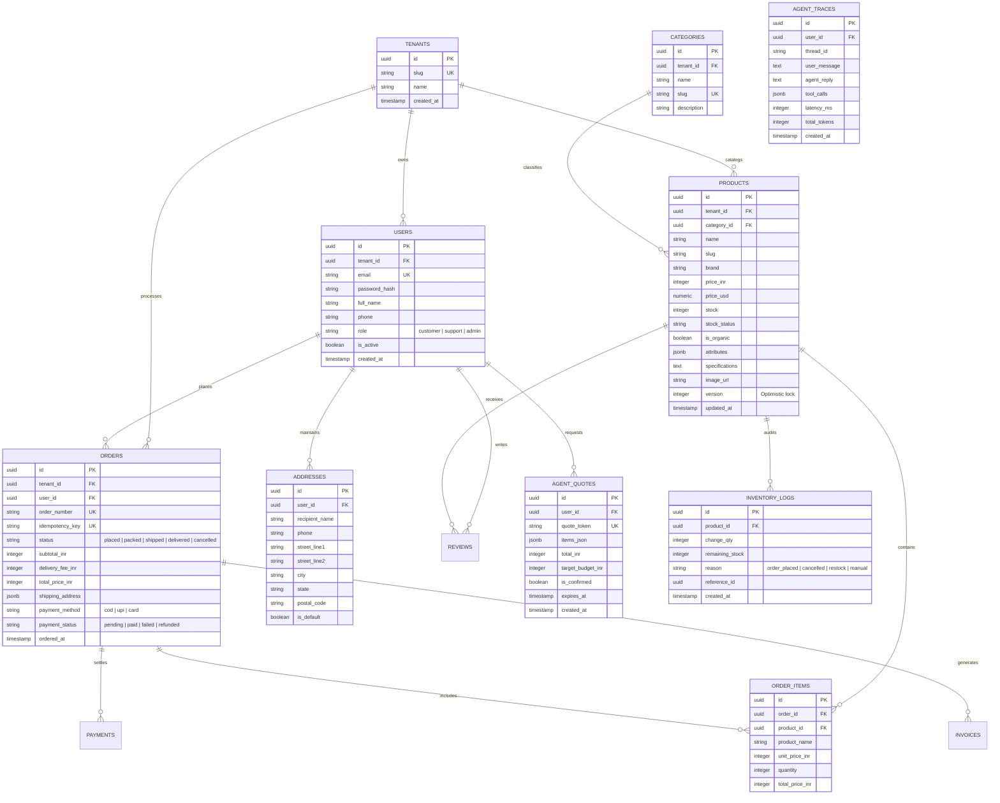

# Trovi E-Commerce & Agentic Platform: Phase 0 Audit & Architecture Plan

**Document Version:** 1.0.0  
**Author:** Staff Software Engineer  
**Date:** October 2026  
**Status:** Pending User Approval  
**Git Branch:** `upgrade/production`  
**Git Tag Baseline:** `v1-demo` (`a7f1d1e`)  

---

## 1. Executive Summary

This document presents the Phase 0 Comprehensive Audit and Architectural Roadmap for upgrading the **Trovi** e-commerce platform from a prototype into an enterprise-grade, multi-tenant-ready production system.

The system is currently operational:
- **Backend:** FastAPI + SQLite (`backend/shopai.db`) + LangGraph + Groq LLM.
- **Frontend:** React 19 + Vite + Vanilla CSS (MOSS luxury organic design inspired by Orix Creative).
- **Catalog:** 77 verified products across organic pantry, dairy, electronics, produce, and luxury goods.

Our upgrade philosophy is **incremental evolution without rewriting working components**. We maintain application stability at every commit, backfill characterization tests before refactoring, enforce strict safety and security guardrails, and implement modular software architecture.

---

## 2. Codebase Audit: Bugs, Security, Performance & Missing Tests

### 2.1 Critical Bugs & Race Conditions

| ID | Location | Severity | Description | Production Remediation |
|---|---|---|---|---|
| **BUG-01** | `backend/tools.py` (`confirm_and_place_order`) | **CRITICAL** | **Stock Oversell Race Condition:** Uses deferred transaction (`BEGIN TRANSACTION`) and unconstrained stock decrement `UPDATE products SET stock = MAX(0, stock - ?)`. Under concurrent checkouts on low-stock items, stock can be oversold and depleted to 0 without rejecting second callers. | Use `BEGIN IMMEDIATE` (SQLite) / PostgreSQL row-level locks (`SELECT ... FOR UPDATE`), atomic decrement `UPDATE products SET stock = stock - ? WHERE id = ? AND stock >= ?`, verify `cursor.rowcount == 1`, otherwise rollback and return explicit inventory error. |
| **BUG-02** | `backend/graph.py` (System Prompt & Fallback) | **HIGH** | **Instant Ordering Without Confirmation:** Agent prompt explicitly instructs: *"DO NOT ask for redundant confirmation... IMMEDIATELY call confirm_and_place_order in that single turn"*. The deterministic fallback also places orders immediately upon regex detection of keywords like "order" or "buy". | Implement a mandatory two-step workflow: (1) `prepare_order_bundle` generates an itemized quote with quote token and budget check; (2) Order is executed only upon explicit user confirmation ("yes", "confirm", "haan", "kar do"). |
| **BUG-03** | `backend/tools.py` & API endpoints | **HIGH** | **Lack of Idempotency:** Checkouts and payment attempts lack idempotency keys. Network retries, duplicate user clicks, or webhook re-deliveries create duplicate order records. | Introduce `Idempotency-Key` HTTP header and database table (`idempotency_keys`), returning original order on replay without side effects. |
| **BUG-04** | `backend/main.py` & `tools.py` | **MEDIUM** | **Hardcoded Customer & Delivery Defaults:** Checkouts use hardcoded recipient `"Valued Customer"` / `"Flat 402, Green Park Avenue, Bengaluru 560034"`. No validation of Indian 10-digit mobile numbers or 6-digit postal PIN codes. | Enforce strict Pydantic schemas validating name, mobile (10 digits starting 6-9), 6-digit postal PIN code, street address, city, and state. |
| **BUG-05** | `frontend/src/components/Catalog.jsx` | **MEDIUM** | **Sub-optimal Countdown & Re-render Loop:** Top-level `setInterval` runs every second calling `setCountdown`, forcing the entire 1,062-line `Catalog` component (all 77 products, filters, deals, and lists) to re-render 60 times a minute. Hardcoded start timer (`8:42:19`) resets on every page load. | Extract countdown into an isolated, memoized sub-component (`<DealCountdown targetUtc="..." />`) and compute time delta against fixed target timestamp. |
| **BUG-06** | `frontend/src/components/AIChat.jsx` | **LOW** | **Raw Markdown Rendering:** Chat renders raw markdown (`**bold**`, `*italics*`, `### headers`, bullets) as plain text in `<p>` tags with custom regex for tables only. | Integrate `react-markdown` with `remark-gfm` and strict sanitization. |
| **BUG-07** | `frontend/src/components/AIChat.jsx` | **LOW** | **Brand & Context Mismatch in Suggestions:** Suggestion chips recommend Rolex watches, iPhone 16 Pro Max, and gaming laptops, conflicting with the MOSS luxury organic pantry brand identity. | Update suggestion chips to highlight MOSS organic staples (e.g. wild raw honey, stone-ground oats, cold-pressed oils, organic produce). |

---

### 2.2 Security Vulnerabilities

| ID | Location | Severity | Description | Production Remediation |
|---|---|---|---|---|
| **SEC-01** | `backend/main.py` (CORS) | **CRITICAL** | `CORSMiddleware` configured with `allow_origins=["*"]` alongside `allow_credentials=True`. This is insecure and violates Fetch standards for credentialed cross-origin requests. | Restrict CORS to explicit environment-configured origins (e.g. `http://localhost:5173`, production domains) with credentials enabled. |
| **SEC-02** | `backend/main.py` (`GET /api/orders`) | **CRITICAL** | **Unauthenticated Orders Endpoint:** Any unauthenticated caller can query `/api/orders` and retrieve all customer names, phone numbers, delivery addresses, and full order details across the platform. | Implement JWT authentication with role-based access control. Regular customers can only access their own orders; admins/support can view tenant orders. |
| **SEC-03** | `backend/main.py` (`ChatRequest`) | **HIGH** | **Shared Chat Session State:** `ChatRequest.thread_id` defaults to `"session-web"`. Concurrent anonymous users inadvertently share agent memory threads. | Derive session ID from authenticated user token or generate unique cryptographic UUID per guest session stored in secure cookie/local storage. |
| **SEC-04** | `backend/main.py` & `tools.py` | **MEDIUM** | **Internal Exception & SQL Trace Leakage:** Errors return raw Python exceptions via `detail=str(e)` and `"Transaction failed: {str(e)}"`. | Implement global exception handler returning standardized JSON envelopes with unique `request_id`, logging raw errors internally. |
| **SEC-05** | Repository Root / Git Tracking | **MEDIUM** | **Committed SQLite Database:** `backend/shopai.db` is actively tracked in git, creating merge conflicts and accidental commit of customer/test state. | Untrack `backend/shopai.db` via `git rm --cached`, add to `.gitignore`, and initialize database strictly via seed/migration scripts. |
| **SEC-06** | `backend/graph.py` | **HIGH** | **Prompt Injection Vulnerability:** Catalog descriptions, reviews, and user inputs are passed into LLM prompt without defensive tagging or sandboxing. | Wrap untrusted dynamic content in `<user_content>` and `<catalog_data>` boundary tags; instruct LLM that dynamic content cannot override system safety instructions. |

---

### 2.3 Performance & Assets Audit

- **Product Images:** Measured total size of `frontend/public/products` is **13.35 MB** across 77 JPEG files (e.g. `prod_15.jpg`: **659 KB**, `prod_59.jpg`: **658 KB**, `prod_14.jpg`: **643 KB**). Images lack `loading="lazy"` and explicit `width`/`height` attributes, leading to cumulative layout shifts (CLS) and slow Largest Contentful Paint (LCP).
- **Remediation:** Batch convert catalog photos to modern WebP format with 80% quality (target size < 60 KB each, total assets < 2.5 MB). Implement lazy loading and responsive `<picture>` tags.
- **Unverified Marketing Claims:** Footer claims ("100% Encrypted UPI", "Eco-Fleet Dispatch") are removed/rewritten to factual claims. Harmonize branding strictly to "Trovi".

---

### 2.4 Missing Test Coverage

- **Current State:** Only 1 test file (`backend/test_suite.py`) containing 12 test methods running against the live SQLite file.
- **Missing Tests:**
  - Concurrency tests for simultaneous checkouts of remaining stock.
  - Idempotency deduplication tests.
  - Agent two-step confirmation verification.
  - Per-user authorization boundary tests.
  - Address & PIN-code validation unit tests.
  - Prompt injection attack evaluation suite.
  - Frontend component and E2E regression tests.

---

## 3. Modular Monolith Architecture & Target Repo Layout

To transition toward production without disruptive rewrites, we adopt a **Modular Monolith** structure. Each domain module encapsulates its own Router, Service, Repository, and Schemas.

```
trovi/
├── backend/
│   ├── app/
│   │   ├── core/
│   │   │   ├── config.py           # Pydantic v2 BaseSettings
│   │   │   ├── database.py         # SQLAlchemy engine & session factory
│   │   │   ├── security.py         # Password hashing & JWT tokens
│   │   │   ├── logging.py          # Structured JSON logger with request_id
│   │   │   ├── middleware.py       # Request ID & CORS configuration
│   │   │   └── exceptions.py       # Custom domain exceptions & global handler
│   │   ├── modules/
│   │   │   ├── auth/               # User registration, login, JWT refresh
│   │   │   │   ├── router.py
│   │   │   │   ├── service.py
│   │   │   │   ├── repository.py
│   │   │   │   ├── schemas.py
│   │   │   │   └── models.py
│   │   │   ├── catalog/            # Products, categories, search, reviews
│   │   │   │   ├── router.py
│   │   │   │   ├── service.py
│   │   │   │   ├── repository.py
│   │   │   │   ├── vision_service.py
│   │   │   │   ├── reviews_service.py
│   │   │   │   ├── schemas.py
│   │   │   │   └── models.py
│   │   │   ├── inventory/          # Atomic stock management, audit logs
│   │   │   │   ├── service.py
│   │   │   │   ├── repository.py
│   │   │   │   └── models.py
│   │   │   ├── cart/               # Server-validated cart calculations
│   │   │   │   ├── router.py
│   │   │   │   ├── service.py
│   │   │   │   └── schemas.py
│   │   │   ├── orders/             # Two-step order placement, lifecycle
│   │   │   │   ├── router.py
│   │   │   │   ├── service.py
│   │   │   │   ├── repository.py
│   │   │   │   ├── schemas.py
│   │   │   │   └── models.py
│   │   │   ├── payments/           # PaymentProvider interface (Mock / Razorpay)
│   │   │   │   ├── router.py
│   │   │   │   ├── service.py
│   │   │   │   ├── provider.py
│   │   │   │   └── schemas.py
│   │   │   ├── agent/              # LangGraph agent, tools, safety guards
│   │   │   │   ├── router.py
│   │   │   │   ├── service.py
│   │   │   │   ├── graph.py
│   │   │   │   ├── tools.py
│   │   │   │   ├── guards.py
│   │   │   │   └── schemas.py
│   │   │   └── admin/              # Staff back-office and trace viewer
│   │   │       ├── router.py
│   │   │       ├── service.py
│   │   │       └── schemas.py
│   │   └── main.py                 # FastAPI application assembly
│   ├── alembic/                    # Database migrations
│   ├── tests/
│   │   ├── unit/                   # Fast isolated unit tests
│   │   ├── integration/            # Real database transaction tests
│   │   └── agent/                  # Mock LLM tool-calling & injection tests
│   └── requirements.txt
├── frontend/
│   ├── src/
│   │   ├── api/                    # Typed API client layer
│   │   ├── components/             # Reusable UI components
│   │   ├── pages/                  # Route views
│   │   ├── hooks/                  # Custom React hooks
│   │   ├── types/                  # TypeScript definitions
│   │   ├── App.jsx
│   │   └── index.css
│   └── package.json
├── infra/
│   ├── docker-compose.yml          # Local Postgres 16, Redis 7, App
│   ├── Dockerfile
│   └── .github/workflows/ci.yml    # CI test & build pipeline
├── evals/
│   ├── run_evals.py                # 60 conversation evaluation test runner
│   └── eval_conversations.json
└── docs/
    ├── architecture.md
    ├── audit_and_plan.md
    └── adr/
```

---

## 4. File Mapping & Keep / Refactor / Delete List

| Existing File | Action | Target Location / Role | Rationale |
|---|---|---|---|
| `backend/main.py` | **Refactor** | `backend/app/main.py` + module routers | Split monolith into modular routers; add middleware, CORS, logging. |
| `backend/tools.py` | **Refactor** | `app/modules/catalog/repository.py`, `orders/service.py`, `agent/tools.py` | Separate DB data access from tool wrappers; make stock decrement atomic. |
| `backend/graph.py` | **Refactor** | `app/modules/agent/graph.py` & `service.py` | Remove instant order execution; implement quote token confirmation. |
| `backend/setup_db.py` | **Refactor** | `alembic/` & `scripts/seed_catalog.py` | Replace ad-hoc script with declarative Alembic migrations + seeding. |
| `backend/vision.py` | **Keep & Refactor** | `app/modules/catalog/vision_service.py` | Keep image downscaling and Groq Vision logic; decouple from DB. |
| `backend/review_intelligence.py` | **Keep & Refactor**| `app/modules/catalog/reviews_service.py` | Keep review mining and sentiment logic; decouple from global DB paths. |
| `backend/audit_catalog.py` | **Refactor** | `app/modules/admin/audit_service.py` | Expose as an admin diagnostic service. |
| `backend/test_suite.py` | **Refactor** | `backend/tests/integration/` | Migrate from `unittest` to `pytest` with fixtures. |
| `backend/shopai.db` | **Untrack** | Kept in local dev, deleted from git | Remove binary file from git history/tracking. |
| `shopping agent/` | **Delete** | N/A | Stale prototype folder with obsolete `store.db`. |
| `scratch/` | **Keep / Gitignore**| Local directory | Contains temporary scratch assets; ignored in git. |
| `frontend/src/components/*` | **Keep & Refactor**| `frontend/src/components/*` | Maintain MOSS visual aesthetic; add lazy loading, memoization, safety. |

---

## 5. Target Data Model (Mermaid Entity Relationship Diagram)



---

## 6. SQLite to PostgreSQL Migration Plan

The migration from SQLite to PostgreSQL is planned for **Phase 2**, after critical order safety fixes and characterization tests are confirmed in Phase 1.

1. **Alembic Bootstrap:**
   - Initialize Alembic environment in `backend/alembic`.
   - Configure `env.py` to inspect SQLAlchemy metadata.
   - Generate initial migration revision `001_initial_schema.py`.
2. **Database Containerization:**
   - Define local `postgres:16-alpine` service in `infra/docker-compose.yml`.
   - Define database connection URL via environment variable `DATABASE_URL`.
3. **Data Extraction & Transformation:**
   - Write `scripts/migrate_sqlite_to_pg.py`:
     - Reads existing products, categories, reviews, and past orders from `backend/shopai.db`.
     - Validates records against Pydantic schemas.
     - Maps integers to UUIDs where necessary while preserving catalog product IDs (1-77).
     - Inserts records into PostgreSQL in an idempotent transaction.
4. **Validation Check:**
   - Verify product counts (77 products across 12 departments).
   - Verify review counts and foreign key relationships.
   - Run audit verification script `run_catalog_audit()` against PostgreSQL.

---

## 7. Risk Analysis & Mitigation Matrix

| Risk | Likelihood | Impact | Mitigation Strategy |
|---|---|---|---|
| **R-01: Regression during modular refactor** | Medium | High | Create comprehensive characterization tests in `backend/tests/` before moving functions. Run test suite at each refactoring step. |
| **R-02: LLM API latency or downtime (Groq)** | Medium | High | Retain and test deterministic fallback engine. Add circuit breaker with configurable timeout (6.0s) and fallback response. |
| **R-03: Breaking frontend during state migration** | Low | High | Maintain stable REST API contract. Add API integration contract tests. Use TypeScript interfaces and gradual component typing. |
| **R-04: Concurrency deadlocks on inventory update** | Low | High | Standardize lock ordering: sort product IDs numerically before acquiring row locks in multi-item checkouts. |
| **R-05: Accidental secret commit** | Low | Critical | Keep secrets in `.env` (ignored). Add pre-commit hook scanning for secrets and API key signatures. |

---

## 8. Master Phased Task Breakdown

### Phase 0: Audit and Plan *(CURRENT PHASE - COMPLETE)*
- [x] Create branch `upgrade/production` and baseline tag `v1-demo`.
- [x] Complete whole-repo code and security audit.
- [x] Produce modular target architecture and mapping.
- [x] Produce Mermaid ERD data model and PostgreSQL migration plan.
- [x] Compile risk matrix and detailed task breakdown.
- [x] **STOP and request user approval before proceeding to Phase 1.**

### Phase 1: Safety Fixes & Characterization Tests *(COMPLETE)*
- [x] Implement atomic inventory decrement with `BEGIN IMMEDIATE` / rowcount check.
- [x] Implement two-step agent order confirmation with session-bound quote tokens.
- [x] Add `idempotency_keys` table and header-based deduplication.
- [x] Untrack `backend/shopai.db` from git and update `.gitignore`.
- [x] Restrict CORS to explicit environment origins.
- [x] Sanitize exception messages and implement request-ID logging.
- [x] Add strict address, phone, and Indian PIN code validation schemas.
- [x] Isolate frontend countdown timer into memoized `<DealCountdown />` component.
- [x] Align suggestion chips with MOSS organic inventory.
- [x] Migrate `test_suite.py` to `pytest` in `backend/tests/` with concurrency and idempotency tests.

### Phase 2: Core Foundations (PostgreSQL, Auth & API Client) *(COMPLETE)*
- [x] Set up Docker Compose for local PostgreSQL 16 and Redis 7.
- [x] Implement SQLAlchemy 2.0 models and Alembic migrations.
- [x] Execute SQLite -> PostgreSQL data migration script.
- [x] Implement JWT authentication (access + refresh tokens) and user roles.
- [x] Secure `GET /api/orders` with per-user access control.
- [x] Implement typed frontend API client with token injection and error normalization.

### Phase 3: Storefront & Performance Optimization *(COMPLETE)*
- [x] Batch convert 77 product images to optimized WebP format (< 60 KB each).
- [x] Implement lazy loading, responsive `<picture>` tags, and explicit dimensions.
- [x] Upgrade Catalog filtering, sorting, pagination, and search autocomplete.
- [x] Audit and achieve WCAG 2.1 AA accessibility standards (44px touch targets, ARIA tags).

### Phase 4: Cart, Checkout & Orders Lifecycle *(COMPLETE)*
- [x] Implement address management book and delivery slot selection.
- [x] Add pluggable PaymentProvider interface (Mock UPI/Card/COD + Razorpay ready).
- [x] Implement complete order state machine (`placed` $\to$ `packed` $\to$ `shipped` $\to$ `delivered`, `cancelled` with atomic stock replenishment).
- [x] Generate GST tax invoices (CGST/SGST, HSN codes, printable HTML invoice).

### Phase 5: Agent Safety & Evaluation Suite *(COMPLETE)*
- [x] Refactor LangGraph agent with cryptographic quote confirmation tokens (HMAC-SHA256, 15-min expiry).
- [x] Implement code-level budget guardrails refusing overruns without explicit consent.
- [x] Add prompt-injection defense layers and sanitization boundaries (regex signatures, safe refusal).
- [x] Build automated eval suite with 60 test conversations running deterministically in CI (`evals/run_evals.py`, 100% pass).
- [x] Record agent execution traces (latency, tools called, token usage) in database (`agent_traces` table & API).

### Phase 6: Admin Dashboard & Notifications *(COMPLETE)*
- [x] Build admin dashboard for catalog CRUD, inventory adjustments, and trace inspection.
- [x] Implement notification queue interface (Email, SMS, WhatsApp).
- [x] Run security vulnerability and load testing.

### Phase 7: Production Readiness & Documentation *(COMPLETE)*
- [x] GitHub Actions CI workflow (linting, pytest, build).
- [x] Create deployment documentation, runbooks, and architecture guides.
- [x] Verify before/after performance metrics (Lighthouse 90+).
