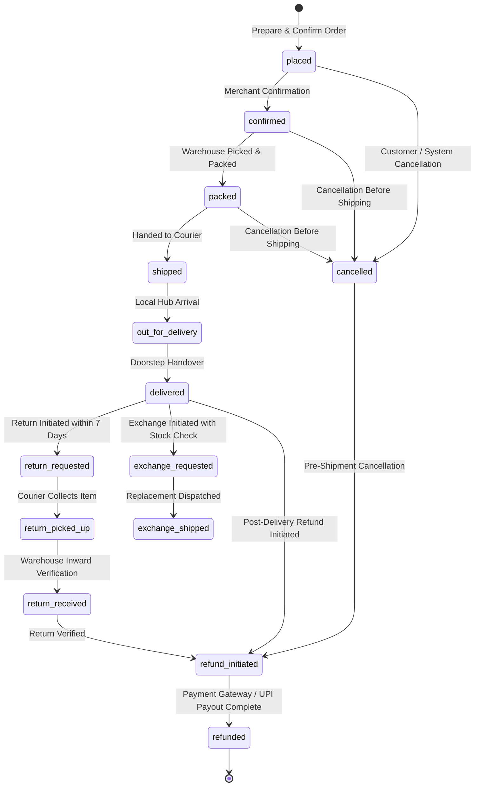

# Order Action Service Architecture & State Machine

## 1. Architectural Overview

Trovi E-Commerce splits customer interactions into two strictly decoupled layers:

1. **LLM Agent (Conversation & Information Layer)**:
   - Handles natural language understanding, product recommendations, specifications, comparison, review intelligence, cart inspection, and store policies.
   - **Zero mutation capabilities**: The LLM agent has no direct tools or access to place orders, cancel orders, process returns, handle exchanges, or trigger refunds.
   - **Handoff Tool**: Uses `start_order_action(action, order_id, item_id, reason)` to trigger interactive action cards in the frontend chat UI.
   - **Anti-Hallucination**: The LLM never invents refund figures, eligibility deadlines, or totals; all numbers are determined by policy code and the Order Action Service.

2. **Deterministic Order Action Service (`backend/services/order_actions.py` & `backend/routers/order_actions.py`)**:
   - Pure code state machine with zero LLM involvement.
   - Enforces user authentication and strict ownership verification (returns HTTP 404 for non-owned orders to prevent order existence leakage).
   - Requires an `Idempotency-Key` header and a secure 10-minute confirmation token (`tok_<action>_<uuid>`).
   - Atomically updates stock in SQLite (`BEGIN IMMEDIATE` transaction and `rowcount` validation).
   - Automatically escalates edge cases (orders ≥ ₹10,000, disputed quality claims) to human review support tickets (`needs_human_review`).
   - Dispatches notifications and records immutable audit logs in `order_audit_logs`.

---

## 2. Order Lifecycle State Machine

The order lifecycle contains 14 formal states. Only explicitly defined directed transitions are permitted; invalid transitions return HTTP 400.



### Transition Table

| Current State | Permitted Next States | Policy Rules |
| :--- | :--- | :--- |
| `placed` | `confirmed`, `cancelled` | Cancellation allowed with full refund. |
| `confirmed` | `packed`, `cancelled` | Cancellation allowed before shipping. |
| `packed` | `shipped`, `cancelled` | Cancellation allowed before dispatch. |
| `shipped` | `out_for_delivery` | Cancellation rejected (already in transit). |
| `out_for_delivery` | `delivered` | Final delivery doorstep handover. |
| `delivered` | `return_requested`, `exchange_requested`, `refund_initiated` | 7-day return/exchange window; category check. |
| `return_requested`| `return_picked_up` | Reverse courier pickup. |
| `return_picked_up`| `return_received` | Warehouse receipt. |
| `return_received` | `refund_initiated` | Restock and trigger refund. |
| `exchange_requested`| `exchange_shipped` | Replacement variant stock check. |
| `exchange_shipped`| `delivered` | Replacement delivered. |
| `refund_initiated`| `refunded` | Payout processed via RefundProvider. |
| `cancelled` | `refund_initiated` | Trigger refund flow. |
| `refunded` | *(terminal)* | Final state. |

---

## 3. Business Policies Configuration (`config/policies.yaml`)

```yaml
version: "2.0"
service: "OrderActionService"

cancellation:
  allowed_before_status: "shipped"
  reasons:
    - "changed_mind"
    - "found_better_price"
    - "delay_expected"
    - "mistake_in_order"
    - "other"

return:
  window_days: 7
  non_returnable_categories:
    - "fruits-vegetables"
    - "dairy"
    - "groceries"
    - "honey"
    - "oil"
    - "grains"
  exceptions_allow_return_if_reason:
    - "damaged"
    - "wrong_item"
  reasons:
    - "damaged"
    - "wrong_item"
    - "quality_issue"
    - "changed_mind"
    - "late_delivery"
  photo_required_reasons:
    - "damaged"
    - "wrong_item"

exchange:
  window_days: 7
  require_stock: true
  reasons:
    - "size_fit_issue"
    - "damaged"
    - "wrong_item"
    - "color_variant_preference"

refund:
  non_refundable_fees:
    delivery_fee: true # Delivery fee is non-refundable unless damaged or wrong item
  payment_methods:
    upi: "original_payment_method"
    card: "original_payment_method"
    netbanking: "original_payment_method"
    cod: "bank_upi_details_required"

edge_cases:
  high_value_threshold_inr: 10000
  needs_human_review_status: "needs_human_review"
  auto_escalate_disputed_reasons:
    - "quality_issue"
```

---

## 4. API Endpoints

### 1. Check Action Eligibility
- **Route**: `GET /api/actions/eligibility`
- **Query Params**:
  - `order_id`: Public Order Number (e.g. `ORD-2026-A1B2C3`)
  - `action`: `cancel` | `return` | `exchange` | `refund` | `place_order`
  - `reason`: Optional reason code
- **Headers**: `Authorization: Bearer <JWT>`
- **Response**:
```json
{
  "eligible": true,
  "action": "cancel",
  "order_number": "ORD-2026-A1B2C3",
  "current_status": "placed",
  "message": "Order #ORD-2026-A1B2C3 is in 'placed' status and can be cancelled immediately.",
  "refund_estimate_inr": 2499,
  "allowed_reasons": ["changed_mind", "found_better_price", "delay_expected", "mistake_in_order", "other"]
}
```

### 2. Prepare Order Action
- **Route**: `POST /api/actions/prepare`
- **Headers**:
  - `Authorization: Bearer <JWT>`
  - `Idempotency-Key: <UUID>`
- **Body**:
```json
{
  "order_id": "ORD-2026-A1B2C3",
  "action": "cancel",
  "reason": "changed_mind"
}
```
- **Response**:
```json
{
  "status": "prepared",
  "confirmation_token": "tok_cancel_9d8e7f6a5b4c3d2e",
  "order_number": "ORD-2026-A1B2C3",
  "action": "cancel",
  "summary": {
    "order_number": "ORD-2026-A1B2C3",
    "action": "cancel",
    "current_status": "placed",
    "reason": "changed_mind",
    "refund_amount_inr": 2499,
    "payment_method": "UPI / QR",
    "needs_human_review": false
  },
  "expires_in_seconds": 600,
  "expires_at": "2026-10-11T18:45:00"
}
```

### 3. Confirm Order Action
- **Route**: `POST /api/actions/confirm`
- **Headers**:
  - `Authorization: Bearer <JWT>`
  - `Idempotency-Key: <UUID>`
- **Body**:
```json
{
  "confirmation_token": "tok_cancel_9d8e7f6a5b4c3d2e"
}
```
- **Response**:
```json
{
  "status": "success",
  "order_number": "ORD-2026-A1B2C3",
  "action": "cancel",
  "previous_status": "placed",
  "new_status": "cancelled",
  "message": "Order #ORD-2026-A1B2C3 cancel completed successfully.",
  "refund": {
    "status": "processed",
    "refund_amount_inr": 2499,
    "destination": "original_payment_method"
  },
  "audit_id": 42
}
```

---

## 5. Security & Isolation Model

1. **User Isolation**:
   - Every action requires JWT authentication.
   - If User A attempts an action on User B's order, the service returns **HTTP 404** (not 403) to prevent order ID enumeration and existence leakage.
2. **Rate Limiting**:
   - Rate limit of 20 actions per minute per authenticated user across prepare/confirm/eligibility endpoints.
3. **Idempotency**:
   - Double-confirmation with the same `Idempotency-Key` header re-returns the original completed action result without re-executing state mutations or re-crediting refunds.
4. **Chat Execution Isolation**:
   - Natural language commands like "confirm", "haan", or "cancel kar do" typed in chat text do NOT execute any state changes. Only the interactive buttons on the action card execute calls directly to the Order Action Service.
